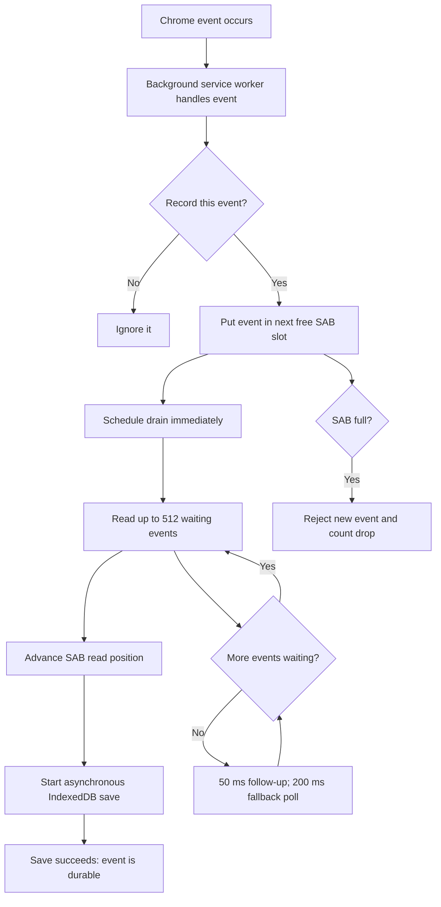

# Tabot data flow and failure handling

This document explains the current source implementation: Chrome capture → local storage → dashboard, plus the optional MCP connection used by assistants. It describes actual safeguards, failure behavior, and missing guarantees—not an idealized design.

**Bottom line:** Tabot is local-first, best-effort activity capture with on-demand, read-only MCP queries. It is **not** a durable message broker, an exactly-once pipeline, or cloud history sync. Reconnection restores communication; it does not replay missing telemetry or failed tool calls.

Source was inspected in the working tree, including existing staged edits. Provider-specific connection-status changes were also in progress during this review; see [verification](#11-verification). Source behavior is not proof that deployed extension, dashboard, and Worker versions match.

## 1. Architecture: two branches, not one upload chain

The dashboard does **not** forward browser history to MCP. Dashboard and MCP independently read the extension's local data.

```text
LOCAL CHROME PROFILE

Chrome tabs / navigation / window / idle APIs
                  +
Content script: visibility, scroll, click, key-activity presence
                  │ chrome.runtime.sendMessage for page events
                  ▼
Extension background service worker
  - tracking and foreground checks
  - sole ring-buffer producer
  - URL/favicon metadata sidecar in memory
                  │
                  ▼
SharedArrayBuffer + Atomics
  10,000 slots; numeric fields only; transient memory
                  │
                  ▼
Inline drain INSIDE SAME background service worker
  up to 512 events per pass
  decode → update counters → advance read index → enrich → async bulkPut
                  │
                  ▼
Dexie → IndexedDB: tabot_events / events
  persisted normalized events, optional URL/favicon, numeric metadata
                  │
       ┌──────────┴─────────────────────────┐
       │                                    │
       ▼                                    ▼
Popup / dashboard                       Extension MCP handlers
  request persisted events                read local IndexedDB
  derive locally                          derive requested evidence
  render aggregates                       sanitize + project result
       ▲                                    ▲ │
       │ Chrome runtime messaging           │ │ authenticated outbound
       │                                    │ │ WebSocket
Dashboard web page                          │ ▼
(TanStack Start / React)              Cloudflare Worker + installation DO
                                      ▲                │
                                      │ OAuth /mcp     │ requested result
                                      │                ▼
                                      Assistant MCP client
                                      e.g. ChatGPT / Claude
```

**Important correction to older architecture shorthand:** production capture does not currently run a separate aggregation Web Worker. `processBatch()` and `scheduleDrain()` run inline in `apps/extension/background.ts`. `apps/web/src/workers/transport-benchmark.worker.ts` is a benchmark worker, not the production capture consumer. The ring buffer uses shared-memory primitives, but current capture/drain code lives in the same service worker.

### Components and responsibilities

| Component / source | Responsibility | State lifetime |
| --- | --- | --- |
| [Extension manifest](apps/extension/package.json) | Plasmo/MV3 configuration, permissions, external messaging origins, isolation headers | Installed build |
| [Content script](apps/extension/contents/tabot.ts) | Page activity listeners; Pacer throttling; send page-event messages | Page/content-script lifetime |
| [Foreground tracker](apps/extension/foreground.ts) | Focused active tab, idle/lock checks, ordered sampling and sleep-gap handling | Queue in memory; last sample in `chrome.storage.session` |
| [Background](apps/extension/background.ts) | Chrome listeners, capture filtering, SAB producer/consumer, persistence, dashboard RPC, notifications | Mostly transient service-worker state |
| [Buffer](packages/shared/src/events/buffer.ts) | Fixed-size encoding, publication ordering, full-buffer rejection | Memory only |
| [Metadata](packages/shared/src/events/metadata.ts) | Tab URL/title/favicon map; URL/favicon enrichment at drain | Memory only; title is not a persisted event field |
| [Database](packages/shared/src/events/db.ts) | Dexie open, bulk upserts, counts, full/range reads | IndexedDB, local Chrome profile |
| [Shared derivation](packages/shared/src/share/export.ts) | Events → sessions → activity structure → summaries → patterns | Rebuilt on reads; no derived database tables |
| [Dashboard transport](apps/web/src/lib/home-data.ts), [polling hook](apps/web/src/hooks/use-home-data.ts) | Request snapshots from extension and derive data in browser | Page memory; not a cloud replica |
| [Popup](apps/extension/popup.tsx) | Local recap, recording toggle, loss feedback, assistant actions | Popup memory plus stored preferences/high-water marks |
| [Extension relay](apps/extension/relay.ts) | Installation credential, outbound socket, heartbeat, reconnect, local tool execution | Credentials in `chrome.storage.local`; socket/timers in memory |
| [MCP Worker](apps/mcp-server/src/index.ts) | HTTP limits, OAuth endpoints, MCP schemas, authenticated routing | Per-request server/transport; durable auth delegated below |
| [Auth Durable Object](apps/mcp-server/src/auth-store.ts) | OAuth clients, consent transactions, code/token hashes, grant lifecycle, cleanup | Durable indexed SQLite; legacy KV migration |
| [Installation Durable Object](apps/mcp-server/src/installation.ts) | One live extension socket per installation, request correlation, timeout/busy handling | Hibernation-compatible socket; pending calls in memory, not durable jobs |
| [Privacy boundary](packages/shared/src/privacy/sanitize.ts) | Local fail-closed redaction for context/pattern sharing; result allowlisting in relay | Sanitized copies; never rewrites source history |

## 2. Chrome capture → IndexedDB, step by step

### 2.1 What is captured?

- Chrome tab creation, activation, update, removal; main-frame committed navigation.
- Page visible/hidden, scroll offset, click coordinates, and **presence of keyboard activity**.
- Browser-window focus transitions (`SW_WINDOW_FOCUS`). Historical retired SW event types still decode, but are not emitted as new production signals.
- Foreground observation samples every **30 seconds** using `chrome.alarms`, plus samples on tab activation, focus changes, and idle-state changes.

No typed characters, key values, input/form contents, DOM snapshots, page text, screenshots, or audio are captured. URLs and favicons can be stored locally. URLs may contain sensitive paths/query values; local-first is not equivalent to sanitized local storage.

Content script runs at `document_idle`. It throttles scroll and keyboard-activity signals to **150 ms**; intermediate actions are intentionally not preserved. Click/keyboard listeners require trusted events. Non-hidden page signals require document visibility and focus. Nested scroll listeners attach to qualifying elements found during initialization; newly added scroll containers are not automatically discovered.

Foreground checks require active non-incognito tab, focused non-minimized window, and system idle state `active`. Idle threshold is **60 seconds**. Background applies these checks to activation, navigation, visibility and interaction signals; not every lifecycle row is a foreground activity. Derivation applies its own foreground/semantic filtering too.

### 2.2 How does capture enter the buffer?

1. Content script sends `TABOT_PAGE_EVENT`; Chrome lifecycle APIs call background handlers directly.
2. Background awaits tracking preference, rejects paused/irrelevant capture, and calls `pushEvent()`.
3. Each event occupies **8 Int32 fields = 32 bytes**: type, tab ID, window ID, auxiliary metadata, timestamp high/low, two numeric values.
4. Strings stay in a separate tab metadata map, not the SAB.
5. Producer writes the complete slot, then publishes its logical position using Atomics.
6. Drain reads only through `PUBLISHED_INDEX`; physical position is logical index modulo capacity.

A content message includes its page timestamp, but the current background page-event handler does not pass it into `push()`: those rows receive background handling time. Foreground sampler explicitly passes its observation timestamp. Async foreground checks also mean buffer acceptance order is not necessarily original browser callback order.

### 2.3 What makes an event durable?

#### Plain-English map

The same background service worker receives events, puts them in SAB, and drains SAB into IndexedDB. It does not wait for the buffer to fill.



In practice, **512 is a maximum, not a target**: if one event is waiting, the drain takes one. If 700 are waiting, it takes 512, then schedules another drain for the rest.

JavaScript runs one task at a time, so a new Chrome event cannot interrupt the drain halfway through. The drain takes its batch and starts the asynchronous database save; then the service worker can handle more events while that save is still running. Those new events go into SAB and schedule another drain.

`processBatch()` decodes up to **512** rows, updates in-memory stats, and advances `READ_INDEX`. It then enriches rows with the **current** URL/favicon sidecar and starts async Dexie `bulkPut()`.

Wakeups use queued microtasks, a **50 ms** follow-up after a burst, and a **200 ms** fallback poll while the service worker is alive. These timers are not durable background scheduling guarantees.

Database:

```text
Database: tabot_events
Table:    events
Indexes:  id (primary key), timestamp, type, tabId
Event ID: `${timestamp}-${tabId}-${logicalIndex}`
```

**Durability begins after a successful IndexedDB write—not when a message is sent, a slot is accepted, the read index advances, or `eventsProcessed` increases.** There is no end-to-end persisted acknowledgement back to the content script.

`bulkPut()` replaces a row with the same ID. `BulkError` is logged as a partial failure and swallowed by the helper; successful writes may remain committed while failed rows are not retried. Other write errors propagate to background logging. Neither path restores the batch to the ring.

First Dexie open also attempts deletion of legacy `tabot_rxdb`; there is no legacy-record import in that helper.

## 3. IndexedDB → dashboard and popup

Dashboard runs on a different origin from the extension. It cannot directly open the extension's IndexedDB. Instead:

1. `home-data.ts` calls `chrome.runtime.sendMessage`, using configured `VITE_TABOT_EXTENSION_ID` for external messages.
2. Background `onMessageExternal` handles `GET_STATS`, `GET_COUNTS`, `GET_EVENTS` and other supported requests.
3. `GET_EVENTS` reads **all persisted rows**, not buffered/in-flight writes and not only a requested date range.
4. Dashboard holds that array in page memory and calls shared `derive(events)`.
5. Presentational UI receives activity/session/site/pattern data rather than rendering a raw event feed.

**Transport distinction:** raw rows do reach dashboard browser JavaScript through local extension messaging. “Dashboard shows aggregates” does not mean “extension sends only aggregates.” Current code does not upload those rows to a dashboard backend. Approved dashboard-origin JavaScript is therefore part of the trusted local-data boundary.

Shared derivation is approximately:

```text
persisted events
  → foreground / meaningful-event filtering
  → chronological sessions
  → page activity anchors + graph + chronological episodes
  → BrowserContext records (UI: activity summaries)
  → recurring behavioral patterns (internal name: memories)
  → retrieval / local live snapshot
```

No LLM or embeddings run in this pipeline. Activity structure is deterministic for equivalent input/configuration; time-dependent staleness/ranking also depends on the clock. Rebuilding does not append another copy to a derived table: there are no such tables.

Home polls stats every **1 second**, events every **5 seconds**. Popup refreshes its local view every **10 seconds** while open. Ordinary dashboard RPC timeout is **800 ms**. Assistant-status messaging allows **6 seconds**; its extension HTTP status check allows **5 seconds**.

A failed dashboard transport returns `null`; hook retains the last good snapshot. That is stale-data tolerance, not proof of live connectivity. On initial absence it can route to `/extension-not-connected`. Background DB failure currently returns `[]` for `GET_EVENTS` and zero for counts; this is indistinguishable from an empty database at the UI boundary and can replace previously visible history with an empty view.

### Notifications and return visits are another local reader

Background notification checks use a **15-minute alarm**, tracking-enabled gate, **30-minute settlement delay**, **24-hour freshness**, and **6-hour cooldown**. They derive local summaries/patterns, choose new evidence past stored high-water marks, and save selected IDs in `chrome.storage.local`. First initialization seeds marks to now to avoid historical notification backfill.

Current source tries opening popup, then falls back to system notification if Chrome refuses. Notification click opens selected dashboard summary; button opens assistant connection or selected-ID prompt. Startup can open popup for meaningful unseen activity once per local day. These are prompts to inspect local evidence—not automatic history uploads.

Failure limits: delivery and seen-state persistence are not atomic; crash/storage failure between them can repeat or suppress a reminder. Service-worker running guard is not cross-restart deduplication. Notification stores connection state at creation, so later click can use stale connection knowledge. Selected derived ID can also become unavailable. Notification/permission/popup failure is caught/logged; there is no durable notification delivery queue or guaranteed catch-up for every missed insight. A popup visit with unread-state storage failure must not manufacture an unread count.

## 4. Local data → MCP → assistant

### 4.1 Connection and authorization are different

The extension starts its relay even when no dashboard is open and before assistant consent:

1. Load installation ID and signed credential from `chrome.storage.local`.
2. If absent, `POST /installations` creates a random ID and signed **365-day** installation credential. Registration contains no browsing payload.
3. Connect outbound to `/relay` using credential as WebSocket subprotocol. An installation ID alone is not authorization.
4. Worker verifies credential and routes socket to installation-specific Durable Object.

Assistant then authorizes separately through OAuth:

- Dynamic client registration; registered redirect URI validation.
- Authorization code with **PKCE S256**, scope `tabot.context`, and MCP resource binding.
- A **5-minute**, single-use consent transaction approved by extension in the **same Chrome profile**.
- Consent page receives success/failure, not installation credential. Extension proves ownership directly to Worker.
- A **5-minute**, single-use code exchanges for **1-hour** access and **30-day** rotating refresh tokens.
- Auth DO persists client/authorization/token records; token/code secrets are hashed in storage.
- Access token's installation binding determines routing. Caller cannot select someone else's installation by supplying an ID.

MCP endpoint is `/mcp`; extension relay configuration is the Worker **origin without `/mcp`**. Dev, local and production must use matching URLs, signing secrets, extension IDs, and allowed external-message origins. Credentials are scoped separately by relay host; production retains its legacy storage key.

A grant, an open socket, and a discovered tool list are three different states. “Connected” UI is intended to reflect OAuth grants, not guarantee socket availability or tool success. Provider-specific status implementation was changing during this review: new server/parser code uses `{ chatgpt: boolean, claude: boolean }`, whereas earlier clients used `{ connected: boolean }`. Do not assume mixed builds interoperate. New provider labels are inferred from OAuth client name (Claude/ChatGPT/OpenAI), not verified assistant identity; token binding remains the authorization boundary. Dashboard status polling runs every 10 seconds while visible and also refreshes on focus/visibility, with one status request in flight.

### 4.2 One tool call end to end

```text
Assistant → authenticated HTTP /mcp
  → validate token, resource, scope and tool arguments
  → token-bound installation DO
  → allocate UUID requestId + pending entry + 10-second timer
  → send { type: 'request', requestId, method, params } to extension
  → extension reads Dexie and derives requested evidence
  → sanitize context/pattern data; project allowlisted fields
  → send { type: 'response', requestId, result OR error }
  → DO matches requestId AND originating socket; settles once
  → MCP returns one JSON text block, or isError: true
```

HTTP request correlation (`X-Request-Id`) and extension-dispatch UUID are separate identifiers. SDK transport is configured without generated MCP session IDs; there is no application-level persistent tool-result replay log.

Seven read-only tools:

| Tool | Selection / result bound |
| --- | --- |
| `search_context(query, hours?)` | Local domain/sequence token search; query 1–200 characters; optional 1–168 hours; max 8 ready summaries |
| `get_recent_context(hours)` | 1–168 hours; max 20 ready summaries selected after full derivation |
| `get_current_context()` | Latest ready summary overlapping last 24 hours; not proof of current attention/task |
| `get_context(id)` | One exact summary, even if not ready; absent → `found: false`; ID max 256 characters |
| `list_recurring_patterns(limit?)` | All retained contexts derived locally, recurrent-only, newest first; default 10, max 20; bounded response |
| `get_memory(id)` | One pattern plus bounded origin-only supporting occurrences; absent → `found: false`; ID max 256 characters |
| `get_activity_metrics(from, to, origin?)` | Indexed `[from,to)` event read; locally validate `0 <= from < to <= now`; optional exact HTTP(S) origin |

Current pattern helpers derive **full retained history**, matching dashboard—not an old 500-context candidate limit. Output limits do not bound derivation CPU/memory. Metrics use a timestamp index, but a huge requested interval can still select many rows.

Discovery readiness requires at least **10 minutes foreground duration**, **10 events**, and either **2 domains**, **2 sessions**, or **5 interactions**. Empty discovery can mean insufficient evidence, not a broken socket. Exact context lookup bypasses this readiness gate.

### 4.3 What leaves the device?

MCP sends selected summaries or origin-only aggregates—not raw rows, full URLs/paths/query strings, page contents, typed text, credentials, or favicons. Context/pattern handling uses `sanitizeDerived()` plus narrow result projections. Metrics use a restricted origin/aggregate projection instead of raw event export.

Selected email/phone/card/IBAN patterns are detected locally. Redactor failure aborts context/pattern output; there is no unsanitized fallback. This is not universal PII detection: site origins and subdomains deliberately remain visible and may themselves be sensitive.

Worker forwards requested results in memory but does not persist browser history or tool results. This does not mean assistant/provider infrastructure never processes or retains received results. Manual JSONL download is a separate user-controlled export that can contain sanitized event rows and URL structure; it is not the MCP payload and does not upload itself.

## 5. Direct answers to the reliability questions

### Q1. What happens when the connection drops?

There are several independent connections:

| Broken connection | Current effect |
| --- | --- |
| Content script → background | Failed `sendMessage()` is swallowed; event is not queued/retried. Page can remain attached to an invalid old extension context after reload. |
| Dashboard → extension | RPC times out/returns `null`; last good UI snapshot remains. Extension can keep recording without dashboard. |
| Extension → relay WebSocket | Heartbeat stops on close; relay state becomes `offline`; reconnect timer is scheduled. Local capture/database do not depend on network. |
| Socket during an MCP request | DO rejects that socket's pending calls as `extension_disconnected`; no automatic replay. |
| No socket when a tool arrives | Immediate `extension_offline`; server does not queue the tool for later. |
| Assistant → Worker HTTP | Caller may not receive result even if extension completed calculation. Client must decide whether to retry. |

A silent half-open connection may not promptly emit close. Tool requests still have a server-side timeout; extension does **not** track missed pongs or enforce its own liveness deadline.

### Q2. How does reconnection work?

In `relay.ts`:

1. `onclose` stops heartbeat, clears socket reference, marks offline.
2. `scheduleReconnect()` permits one queued reconnect timer.
3. Delay starts at **1 second**, doubles to **60 seconds**, adds random **0–499 ms** jitter.
4. Next attempt reloads existing saved installation credential. It does not register a new identity merely because connection failed.
5. Successful socket open resets backoff to 1 second and sends `ping` every **25 seconds**. DO automatically responds `pong` without waking application code.
6. Repeated starts/connect attempts have `connecting`/socket guards.

Limitations:

- Retry timers live in MV3 service-worker memory; suspension/restart loses them. Background initialization calls `startRelay()` again when worker executes. No durable reconnect alarm exists.
- `onerror` records error but reconnection is driven by close/caught setup failure, not every error callback.
- No explicit timeout on registration fetch, authorization-approval fetch, or WebSocket handshake in this code. A stuck setup can delay retry.
- Invalid/expired saved credentials fail closed and keep failing; no automatic credential renewal or full repair UI. Replacing identity silently would strand existing OAuth grants, so it is deliberately not done.
- Reopening socket neither resends failed calls nor reconstructs missing local events.

### Q3. Can messages or events be lost?

**Yes.** Capture is best-effort, not at-least-once end to end.

Loss windows include:

- Before content script initialization, on restricted pages, missing permission/injection, and extension disabled.
- Intentional throttling/filtering or paused tracking; these are omitted observations, not transport failures.
- Failed page messaging; no source queue or persisted ACK.
- Full ring buffer: new event rejected and `droppedEvents` incremented.
- Service-worker/browser/process termination while event is in memory or write has not committed.
- Database open/write/quota failures, including partial bulk failures; no batch replay.
- Local storage deletion/profile loss/uninstall/eviction; no cloud backup.

MCP requests/results can also be interrupted. There is no durable request/result queue or resume cursor. A failed result delivery does not delete committed local events: retry can recompute a new result from retained data.

`droppedEvents` reports **ring-full rejections only** in current worker lifetime. It does not count failed page messages, filtered observations, DB failures, crashes, or all missing activity. Zero drops is not proof of no loss.

### Q4. How do we avoid duplicate processing?

| Layer | Existing safeguard | What it does not guarantee |
| --- | --- | --- |
| Buffer | Single producer, published boundary, advancing read cursor | No persistent replay checkpoint or cross-restart identity |
| IndexedDB | ID primary key + `bulkPut()` upsert | Same ID overwrites; duplicate observations with different IDs remain separate |
| Derivation/UI | Recompute from snapshot; do not append derived rows on every poll | Not an ingestion deduplication mechanism |
| Meaningful events | Collapse redundant tab-update noise; preserve genuine navigation | Same-URL reload remains meaningful; no universal duplicate filter |
| Relay response | Match UUID and originating socket, delete pending entry on settlement | Duplicate incoming requests can execute handler again |
| OAuth | Single-use transactions/codes/refresh tokens; synchronous read/burn paths | Lost token response has no replay cache; client may need fresh consent |
| Notifications | Stored high-water marks, cooldown, running guard | Notification delivery and marking seen are not one atomic transaction |

Logical event index distinguishes same-millisecond rows and physical slot reuse **within one worker instance**. It resets on service-worker restart. Timestamp usually distinguishes restarts, but IDs are not a formally collision-proof persistent sequence (clock rollback/reuse can collide). Ring counters are signed Int32 and have no long-lived rollover handling either.

MCP correlation provides **one settlement per pending dispatch**, not exactly-once execution. Assistant retry creates a new request UUID and may rerun calculation. Tools are read-only, so that does not double-write browser data; it can consume CPU and return newer evidence.

### Q5. What if consumer cannot keep up?

Three different bottlenecks:

1. **Ring drain slow:** at most 10,000 waiting slots, 512 decoded per pass. Producer does not block browser; full ring rejects **new** arrivals, preserving unread slots. Stats expose capacity/occupancy/peak/drops. Throttling helps but does not remove overload risk.
2. **IndexedDB slow:** ring read cursor already advances before commit. Async writes can accumulate outside ring. There is **no explicit cap on pending persistence batches**, no write-completion backpressure, and no adaptive shedding based on DB latency. Low ring occupancy can coexist with DB backlog/data loss.
3. **MCP derivation slow:** DO allows **32 pending requests per installation**; further dispatch returns `extension_busy`. Each pending request times out after **10 seconds**. Extension handlers can overlap; no dedicated CPU worker/query scheduler/cancellation message. Timeout frees server slot but does not stop local work.

Dashboard additionally fetches all rows and derives on browser main thread every event refresh. There is no incremental snapshot/delta protocol, pagination, or production derivation worker. Large histories can cause message timeouts, memory pressure, UI stalls and relay timeouts. Output caps are not compute/memory caps.

## 6. Negative-case matrix: capture, persistence, dashboard

“Gap” below means no complete safeguard exists today, not a feature this documentation adds.

| Question / failure | Actual behavior and recovery | Limitation / gap |
| --- | --- | --- |
| Internet goes offline? | Capture and committed local data remain independent of relay. Socket retries when closure is detected. | Hosted dashboard still needs to load its assets; no offline/PWA availability guarantee. |
| Dashboard closes? | Extension continues capture; opening dashboard requests fresh persisted data. | Nothing relies on dashboard as a relay bridge. |
| Chrome closes/crashes? | Committed IndexedDB and local credentials normally survive. Browser-session foreground sample does not survive browser close. | Uncommitted/transient events may disappear; no shutdown-flush guarantee or history backfill. |
| MV3 service worker suspends/restarts? | Event listeners/background initialization run again; IndexedDB/local settings remain, foreground session sample survives SW restart. | SAB, stats/drop counts, URL sidecar, timers, pending JS work reset. Chrome alarms do not turn memory into durable storage. |
| Computer sleeps/alarms delayed? | Foreground sample gap over **90 seconds** closes prior attention at last observation, not wake time. | No reconstruction of intervening actions; socket timers are not precise during sleep. |
| User idle, locks device, switches apps or minimizes Chrome? | Foreground checks/samples stop admitting attention; hidden/focus evidence bounds durations. | Measurements are observations/estimates, not proof of attention. |
| Tab closes before async check completes? | `isForegroundTab()` catches missing tab/window and returns false; activation failure is logged. | Some signal/metadata can be absent; no Chrome-event replay. |
| URL changes before drain, or tab metadata removed? | Drain uses current sidecar, or writes row without URL. | URL can reflect later state; `TAB_REMOVED` cleanup and worker reset can lose enrichment. No per-event URL snapshot in SAB. |
| Page stays open after extension update/reload? | Old content-script `sendMessage` rejection is ignored to avoid page errors. | No automatic reinjection/retry in this path; reload affected page to reattach. |
| Chrome internal/store/restricted pages? | Chrome may disallow content-script injection; some tab-level evidence can still exist. | No full page-interaction coverage. `<all_urls>` does not override platform restrictions. |
| Incognito? | Foreground checks reject incognito and manifest does not declare dedicated incognito collection behavior. | Do not treat this as an audited universal incognito firewall: lifecycle handlers are separate. |
| Tracking paused? | `push()` rejects new events; pause state stored locally. Existing history remains readable. | Pause is not deletion, OAuth revocation, or relay disconnect; previously accepted writes may still finish. |
| Tracking preference read/write fails? | Initial read failure is swallowed, leaving default `trackingEnabled = true`; runtime toggle catches and reports current in-memory state. | Persisted preference and runtime state can diverge. No fail-closed pause guarantee on storage failure. |
| SAB unavailable/isolation misconfigured? | Manifest requests isolation headers. | No alternate production capture transport; buffer construction can fail background initialization. Benchmark alternatives are not runtime fallbacks. |
| Ring fills? | Reject newest push, increment lifetime drop counter; popup can show recording-loss feedback. | No spill-to-disk queue, priority policy or replay. |
| IndexedDB cannot open? | Shared DB helper logs/rejects and resets its own cached promise. | Background/relay hold their own cached DB promises; failed first open can remain rejected there until worker reload. |
| Disk quota/storage corruption/write denied? | Log bulk failure; capture continues until other limits intervene. | No retry/dead-letter storage, quota cleanup policy, or complete user-facing write-loss count. |
| Partial batch write failure? | `BulkError` logs failure count; successful puts may persist. | Failed rows not retried; helper returns without propagating partial failure. |
| Database cleared/uninstalled/profile changed? | New store/installation starts empty as applicable. | No cross-profile sync or automatic restore. User downloads are separate files, not an implemented restore service. |
| Clock jumps forward/backward? | Persist wall-clock milliseconds; downstream chronological logic uses those values. | Session boundaries, IDs, cooldowns, readiness/windows can be distorted. No clock synchronization or monotonic cross-restart sequence. |
| Dashboard extension ID/origin wrong? | External message fails/timeout; initial state may show extension-not-connected. | Correct build/env/allowlist then reload. Missing ID is not automatic installed-extension discovery. |
| DB read fails while dashboard polls? | Background returns `[]` / zero; UI can accept it as empty. | Error-vs-empty distinction is missing on this RPC. No history is deleted by the failed read itself. |
| Dashboard loses extension after initial success? | Hook keeps last successful stats/events on `null` replies. | `hasExtension` can stay true; no freshness deadline/stale-data badge guaranteed by this hook. |
| Poll responses race or arrive late? | Per-call `done` guard accepts at most one callback; unmounted hook ignores responses. | Polls can overlap; no global snapshot version prevents older response replacing newer one. Late timed-out work is not cancelled. |
| Data changes between dashboard and MCP reads? | Each independently queries committed store. | No shared transaction/snapshot across clients; temporary differences are expected. |
| Very large history? | Full history retained and repeatedly derived; metrics can use range index. | No retention/compaction cap, all-history paging, incremental cache, or bounded derivation cost. |

## 7. Negative-case matrix: MCP, auth, privacy

| Question / failure | Actual behavior and recovery | Limitation / gap |
| --- | --- | --- |
| Extension offline when tool called? | `extension_offline` immediately; open Chrome with matching extension and try again. | No cloud-history fallback or offline task queue. |
| Socket disconnects/replaced mid-call? | Reject only pending requests belonging to that socket; clear timers. New connection replaces older one. | Pending call is not transferred to new socket. Two clients sharing one credential can repeatedly replace each other. |
| Request send throws? | Remove pending entry, clear timer, return `extension_disconnected`. | No automatic resend. |
| Local handler exceeds 10 seconds? | `extension_timeout`; pending entry removed. | Handler is not cancelled; synchronous heavy work may also delay heartbeats/capture in same service worker. |
| More than 32 outstanding calls? | `extension_busy`; caller can retry later. | No fair queue. Timed-out work can still run, so pending cap is not a strict local-work cap. |
| Response arrives twice, late, or from old socket? | Missing pending ID/wrong socket ignored; settled entry cannot settle twice. | No cache for returning old results to repeated client calls. |
| Extension receives duplicate request? | Handler can execute twice; every call is read-only. | No extension-side processed-request ID ledger. |
| Invalid JSON/binary/oversized extension response? | DO rejects socket's pending calls, closes socket; malformed/size code logged. | Extension outbound result can be lost; client must retry after fault corrected. |
| Context result too large? | Relay rejects frame over **64,000 characters**. Pattern/metric projections trim within roughly **60,000 characters** first. | Context projections do not uniformly pre-trim to budget; one huge domain list can fail a request. Character caps are not byte caps. |
| Unknown tool or invalid args? | MCP SDK/schema rejects unsupported call/input; extension dispatch has unknown-method and handler-error responses too. | Not every local context helper repeats all server validation. Server is authenticated/schema boundary; metrics additionally validate range locally. |
| Local DB or privacy detector fails during tool? | Extension sends error; Worker surfaces MCP `isError: true`, not raw fallback. | Local error codes like `request_failed` map to `internal_error` if not in relay enum. HTTP 200 can still carry tool error. |
| Assistant HTTP request cancelled/lost? | Dispatch may finish anyway; result might never reach caller. | No HTTP-abort → extension-cancellation propagation or replayable response store. |
| Worker/installation DO restarts? | Durable auth storage survives normal restart; socket hibernation supported. | Pending request map is not durable and arbitrary crashes/deploys can interrupt calls; no resumable jobs. |
| Heartbeat pong never arrives? | Extension ignores literal pong responses; relies on networking to eventually close. | No missed-pong counter/watchdog; no fixed upper bound on detecting half-open socket. |
| Saved installation credential malformed/expired? | Reject saved credential or socket auth; retain existing installation rather than silently re-register. | Manual repair needed. Deleting credential creates a new identity needing new consent; avoid casually resetting production identity. |
| Signing secret rotated? | Previously signed installation credentials fail verification. | Planned recovery/re-authorization required; never rotate secret as a routine redeploy step. Existing socket verification happens on upgrade, not every frame. |
| Access token expires? | `/mcp` returns 401 with resource metadata challenge; client can use refresh flow. | Extension socket credential is separate; reconnecting socket does not refresh OAuth access. |
| Refresh token reused/concurrently redeemed? | Read/burn allows one winner; subsequent use gives `invalid_grant`. | If winner's new-token response is lost, old refresh token cannot be replayed to recover it; may require authorization again. |
| Code replay, expired code, wrong verifier/redirect? | Single-use code plus client/redirect/resource/PKCE checks; reject redemption. | Code can be consumed by failed verifier attempt; restart consent instead of endless retry. |
| Wrong OAuth scope/resource or installation ID spoof? | 403 for insufficient scope, 401 for invalid token/resource; routing uses token-bound installation. | CORS alone is not authorization; signed credentials and OAuth checks provide it. |
| Consent in wrong Chrome profile or extension ID mismatch? | Consent cannot obtain matching extension approval. | No QR, pairing code, account login or cross-device fallback; authorize in correct profile/build. |
| Consent transaction expires/not approved? | `/authorize` rejects; transaction lifetime 5 minutes, consumed once after approval. | Start consent again. Approval alone is not an access/refresh grant. |
| User revokes token? | Access-token revocation deletes that token. Refresh-token revocation deletes its **grant family**, including associated rotated access/refresh rows; tombstone prevents legacy migration resurrection. | Does not erase local history or revoke every separate OAuth grant/provider. Already-dispatched work is not cancelled. |
| Auth database full or migration incomplete? | 100,000-record cap; bounded expiry cleanup; capacity/migration errors map to 503/unknown status. Legacy records copied before deletion with idempotent import. | One auth DO is shared capacity domain. Migration is one-way; old KV-only rollback may require reconnecting clients. |
| Client registration ages out? | Unused registrations expire after **90 days**; token issuance renews lifetime; expiry cleanup runs via alarms. | Old client may need register/authorize again. Public lookup cannot renew it indefinitely. |
| Rate-limited/oversized HTTP request? | 429 + `Retry-After: 60`; body >16,384 bytes → 413; URL >8,192 characters → 414. | Limits are per IP **per Cloudflare location**, not global abuse prevention. Shared IP users share budget. |
| Setup abuse against public registration? | Configured public/API limits and auth-record cap reduce unbounded growth. | `/installations` intentionally public; no claim of comprehensive anti-abuse/WAF protection. |
| Malicious site tries extension access? | Chrome `externally_connectable` limits origins; approval additionally checks relay origin and signed installation proof. | Ordinary `GET_EVENTS` relies on origin allowlist, not OAuth. Allowed GitHub Pages/localhost/relay origins are trusted; broad path matches are not per-page isolation. |
| PII sanitizer misses sensitive host/name? | Selected patterns redacted; context/metric/pattern projections remove raw page URL fields. | Origins remain; arbitrary secrets/names and identifying hosts are not universally detected. Do not promise anonymous results. |
| Empty/not-ready result? | Return empty list or `found: false`; discovery evidence gate may hide thin summaries. | Not proof of no browsing/routines. No fabricated data or fallback all-history dump. |
| Activity estimate or inferred task wrong? | Sessions use observed foreground spans; activity metrics use consecutive observations capped at 5 minutes per gap, with no tail extrapolation. Results describe evidence, not intent. | Sparse/missing signals and heuristic segmentation can split/merge incorrectly. Metrics and foreground duration are different estimates; neither measures productivity or proves a task. |
| Selected summary/pattern ID becomes stale? | Exact context lookup returns missing. Memory lookup accepts earlier composite IDs if exact supporting contexts still belong to pattern. | Growing segmentation, deletion or algorithm changes can invalidate IDs; not durable database handles. IDs longer than 256 characters are outside public lookup contract. |
| Connected badge but tools fail/missing? | Grant status independent from live socket and tool discovery. Refresh tool discovery after server/schema changes; verify matching environment. | Status response contracts must match extension/dashboard/server versions; in-progress provider-status changes exposed test mismatch during this review. |
| Onboarding configuration fetch fails? | Shared connect-URL resolver falls back to guided ChatGPT setup prompt on timeout/failure/invalid listing. | Does not establish OAuth or validate successful assistant setup; listing/config uses short cache. |
| Logs leak browsing data? | Worker log API allowlists operational fields; app code logs route patterns/status/latency/tool/error code, not tool payloads. | Platform/provider handling is separate; do not add raw args/results, credential headers, URLs or full responses to logs. |

## 8. Concrete limits and guarantees

| Setting | Current value / meaning |
| --- | --- |
| SAB capacity | 10,000 events; 320,016 bytes including control slots |
| Drain pass | Max 512 rows; not a limit on outstanding DB writes |
| Scroll/key throttle | 150 ms per throttler per content-script instance |
| Foreground / idle / stale sample | 30 s alarm / 60 s idle / >90 s delayed-sample closure |
| Dashboard stats / events | 1 s / 5 s polling; default 800 ms RPC timeout |
| Relay heartbeat | 25 s; no pong deadline |
| Reconnect | 1 s → 60 s capped exponential + 0–499 ms jitter |
| Tool dispatch | 10 s timeout, max 32 pending per installation |
| Extension response frame | Max 64,000 characters, not bytes |
| Pattern / metrics budget | Approx. 60,000 serialized characters plus envelope overhead |
| Metrics output | Max 50 sites / 100 transition pairs; truncation flags; totals can include omitted rows |
| Pattern evidence | Max 20 occurrences, 20 domains, 50-origin sequences, 100 overall supporting IDs and 20 per occurrence |
| HTTP limits | 16 KiB body; 8,192-character URL |
| Configured Worker rate limits | Setup routes: 20/min; API routes: 120/min; per IP per location |
| OAuth lifetimes | Transaction/code 5 min; access 1 h; refresh 30 d; unused client 90 d |
| Installation credential | 365 d; no automatic renewal |
| Auth storage | 100,000 new-record ceiling; cleanup normally every 15 min in bounded batches |

### Safe claims

- A published slot contains fully written numeric fields; full ring does not overwrite unread events.
- Successful IndexedDB writes are retained locally subject to browser storage/profile lifecycle.
- Duplicate writes with the same primary key upsert, rather than create a second row.
- Pending relay response is tied to both request UUID and socket, and settles at most once.
- Offline, busy, timeout, malformed and disconnect conditions have explicit relay errors.
- Context/pattern redaction failure does not fall back to unredacted sharing.

### Claims we cannot make

- Zero loss, complete browser history, exactly-once delivery/execution, or indefinite event-ID uniqueness.
- Crash-safe in-memory queues, durable request replay, automatic recovery of missed page events, or end-to-end persistence ACKs.
- Bounded memory/CPU for all-history derivation or bounded outstanding DB persistence work.
- Instant half-open detection, always-running MV3 timers, or automatic installation-credential repair.
- Dashboard never sees raw rows, universal PII removal, cloud backup, cross-device sync, or no network traffic.
- All deployed versions match source, all tests pass, or live assistant onboarding is verified.

## 9. Operational diagnosis

Use layered checks rather than treating a green badge as end-to-end proof:

1. **Capture:** extension enabled, tracking enabled, normal permitted page, foreground/idle state. Reload stale pages after extension update. Read `GET_STATS` in service-worker console; ring drops are only one loss signal.
2. **Persistence:** compare stats against `GET_COUNTS`; check `bulkInsert failed`, `bulkPut failed`, `bulkPut partial`, or `createEventsDb failed` logs. Processed count can exceed committed count normally while writes are pending; persistent divergence needs investigation. Counters reset after worker restart, DB count does not.
3. **Dashboard:** verify built extension ID and allowed origin; check message response timing. Differentiate `null` transport from `[]`, remembering DB errors currently masquerade as empty.
4. **Relay:** in extension service-worker console, inspect `GET_RELAY_STATUS`: state, relay URL, installation ID and last error. Do not print/copy saved bearer credentials into shared logs.
5. **Worker:** `/health` proves reachability only. An authenticated `/relay/:installationId/ping` round trip checks live extension routing without fetching browsing data; keep credential private.
6. **OAuth:** validate same-profile consent, resource URL ending `/mcp`, scope and unexpired grant. Provider status failures are unknown, not proof of disconnection.
7. **MCP:** verify seven discovered tools, then make authorized read. A successful empty result is different from `isError: true`. Use Worker `tool_call` outcome/error code and `X-Request-Id`; HTTP status alone is insufficient.

Relay codes: `extension_offline`, `extension_busy`, `extension_timeout`, `extension_disconnected`, `malformed_message`, `internal_error`.

`pnpm dev` deploys MCP edits to the **remote dev Worker**; it is not an offline test command. No production deploy or credential reset is needed for ordinary local logic checks. See [relay README](apps/mcp-server/README.md) for environment setup.

## 10. Remaining reliability work, if stronger guarantees are required

These are **not implemented by this documentation**:

1. **Crash/retry durability:** persisted ingestion IDs/checkpoint and bounded durable queue; mark consumed only with successful storage; retry failed rows without changing IDs. Persistent uniqueness needed before adding replay.
2. **Persistence backpressure:** explicit pending-write limit and batch ordering/retry policy, plus visible DB-failure counters separate from ring-full drops.
3. **Honest read errors:** structured dashboard result distinguishing empty/error/stale; freshness/version tracking and no overlapping stale-snapshot replacement.
4. **Scale:** measure full-history costs; add bounded/incremental derivation, retention policy or production worker when measured limits warrant it. Current ring does not offload derivation CPU.
5. **Connection hardening:** pong watchdog, setup/handshake timeout, MV3-aware retry lifecycle and installation-credential renewal/repair without silently changing identity.
6. **Compatibility and acceptance:** synchronized extension/dashboard/Worker contracts, supported protocol/version checks, and real crash/offline/slow-disk/large-history/assistant tests.

Do not add a broker, cloud browser-history storage or exactly-once framework merely to describe stronger guarantees. First decide whether this local activity product needs them; current best-effort behavior must be disclosed either way.

## 11. Verification

Existing local checks run during this review:

| Check | Observed result |
| --- | --- |
| Shared `check:bufferRoundtrip` | Passed; numeric round trips and full-buffer rejection |
| Shared `check:pipeline` | Passed; composed derivation |
| Shared `check:privacy` | Passed; sanitizer behavior |
| Shared `check:memories` | Passed; pattern derivation/identity |
| MCP `check:activityMetrics` | Passed; tool schemas/dispatch/auth/offline mocked paths, metrics/patterns |
| Extension `check:metricsRelay` | Passed; real relay handler with mocked storage/socket, budgets/privacy/errors |
| Extension `check:foreground` | Passed; foreground sampling scenarios |
| MCP `check:production` | **Failed:** `TypeError: auth.hasAssistantConnection is not a function` while provider-status refactor was in progress |

The production check reached relay correlation/send-failure/busy/disconnect/malformed scenarios before failing in auth checks. That is **not** an all-pass result for the script. At failure, server auth code had moved to `getAssistantConnections()` while check still called removed method. Those concurrent application edits were not repaired by this documentation task.

These are constructed/local checks, not fault-injected Chrome lifecycle or live production acceptance. No browser automation, live OAuth, assistant tool invocation, production deployment, disk-quota test or crash-recovery test was performed. Documentation does not turn an uncovered gap into a handled case.

For focused reruns, use scripts declared in the package manifests, for example:

```bash
pnpm --filter @tabot/shared check:bufferRoundtrip
pnpm --filter @tabot/shared check:pipeline
pnpm --filter @tabot/shared check:privacy
pnpm --filter @tabot/shared check:memories
pnpm --filter extension check:foreground
pnpm --filter extension check:metricsRelay
pnpm --filter mcp-server check:activityMetrics
pnpm --filter mcp-server check:production
```

Related documentation: [system walkthrough](docs/system.md), [technical specification](docs/tech.md), [MCP setup](apps/mcp-server/README.md). Where older prose disagrees—separate capture worker, 500-context pattern scope, or token revocation behavior—verify current source files linked above rather than assuming the older description still holds.
